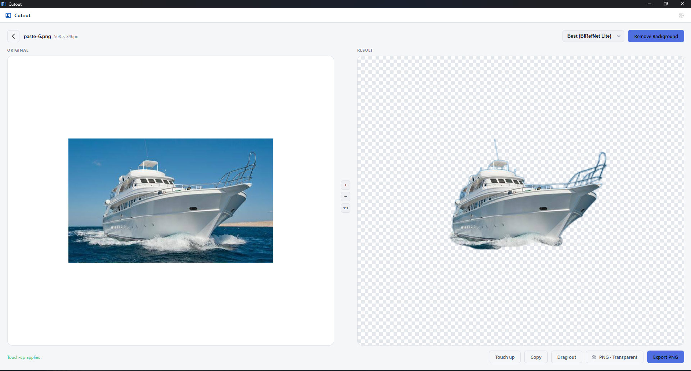
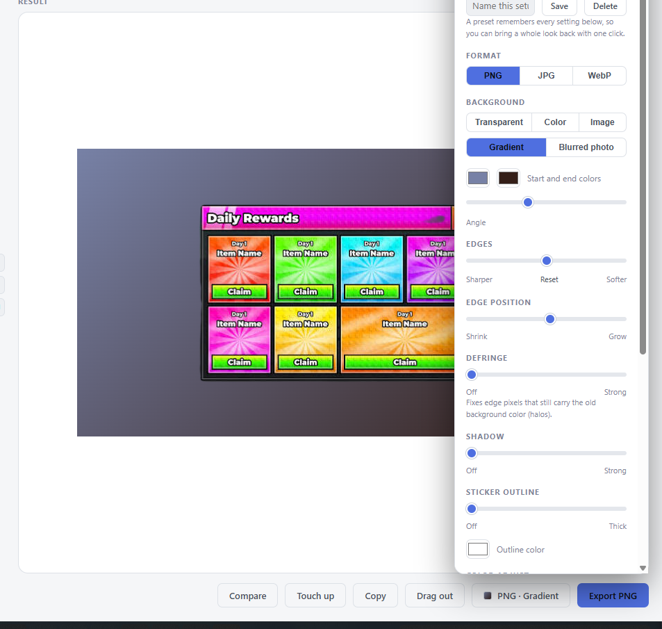
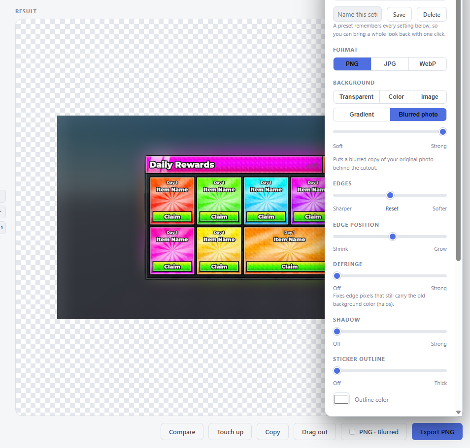
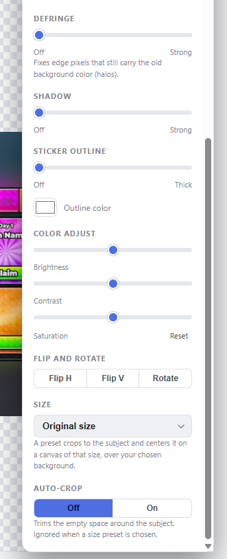
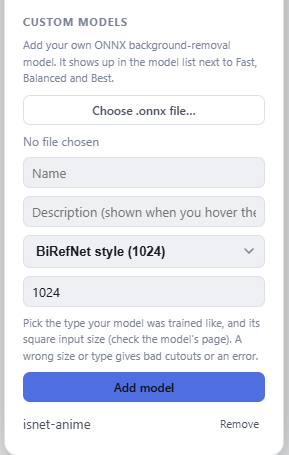
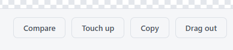

# Cutout

Remove image backgrounds on your own computer. No account, no upload, no
subscription, no resolution limit. Everything runs offline.

## Demo



https://github.com/user-attachments/assets/6aed57b8-a1c2-4c5d-8acc-17a72fbd23e2

https://github.com/user-attachments/assets/6539456f-e150-4a4b-8e6d-6c7438f2d857

## Screenshots

**Gradient background**



**Blurred photo background**



**Export options: color adjust, flip and rotate, size, auto-crop**



**Your own models** (Settings > Custom models)



**Compare, touch up, copy and drag out**



## Community

Encounter any bugs, technical problems or have some feedback? Join the
Discord server: https://discord.gg/BZK6sst4KX

You can also open an issue: https://github.com/gserect-gif/cutout-app/issues

## Features

- Drag and drop, browse, or paste an image (PNG, JPG, WebP, BMP, TIFF, GIF)
- Batch mode: pick several images or a whole folder (subfolders included) and
  export everything at once
- Four built-in AI models, from fast to best quality (see below), plus your
  own: import any compatible ONNX model and give it a name and description
- Output keeps the original resolution. Export as PNG, JPG or WebP
- Backgrounds: transparent, any solid color (color wheel, hex field, or an
  eyedropper that picks a color from anywhere on screen), a two-color
  gradient with an angle, a picture of your choice, or a blurred copy of your
  own photo
- Edge controls: a softness slider (sharper or softer), shrink or grow the
  cutout's edge, and color defringe to remove leftover halos
- Sticker outline with a color and width, and a soft drop shadow
- Brightness, contrast and saturation, flip and rotate
- Size presets (square, portrait, story, thumbnail, ID photo, profile
  picture, banner) or your own custom width and height, and auto-crop to trim
  the empty space around the subject
- Saved presets: name a whole look and bring it back with one click
- Touch-up brush to restore or erase parts the AI got wrong, with undo and
  redo
- Before/after compare slider
- Paste an image with Ctrl+V, copy the finished cutout to the clipboard, or
  drag it straight out of the window into another app
- Live preview: the Result pane shows every setting before you export
- Remembers its window size and position
- Zoom and pan the preview, Dark / Light / System theme
- Cancel any run at any time (Esc works too)

## Install (Windows)

1. Download `Cutout_x.y.z_x64-setup.exe` from the Releases page.
2. Run it.

**Windows may show a blue "Windows protected your PC" (SmartScreen) warning.**
This appears for any new app that isn't code-signed with a paid certificate,
and Cutout isn't signed yet. It doesn't mean anything is wrong with the file.
To continue, click **More info**, then **Run anyway**. You only need to do
this once.

## System requirements

- Windows 10 or 11, 64-bit
- A processor with **AVX2** support. This covers most PCs made since about
  2013-2015. Older CPUs (for example AMD A-series "Kaveri" chips and Intel
  Sandy/Ivy Bridge) can't run the AI engine, and Cutout will tell you so when
  it starts.
- 8 GB of RAM or more recommended. The Best models briefly use several GB
  while processing an image.
- No GPU needed. Cutout runs on the CPU.

## Models

| Name | Speed | Notes |
| --- | --- | --- |
| Fast | quickest | Good for simple subjects and quick checks |
| Balanced | fast | Good everyday default |
| Best | slower | Fine detail such as hair |
| Best+ | slowest | Sharpest results, best for final exports |

Licenses and credits for each model are in `THIRD_PARTY_NOTICES.md`.

### Your own models

Open **Settings > Custom models**, choose a `.onnx` file, give it a name and a
description, pick the model type and its input size, and click **Add model**.
It then appears in the model list next to the built-in ones, and the
description shows when you hover it.

The model must take a single RGB image and return a single-channel mask the
same size as its input. Pick the type it was trained like:

| Type | Input size | Examples |
| --- | --- | --- |
| BiRefNet style | 1024 | BiRefNet models |
| IS-Net style | 1024 | `isnet-general-use`, `isnet-anime` |
| U2-Net style | 320 | `u2netp`, `u2net_human_seg`, `silueta` |

A wrong type or input size gives bad cutouts or an error. Imported models are
copied into Cutout's own data folder, so you can delete the original file.
You are responsible for the license of any model you add.

## Privacy

Cutout never connects to the internet to process images. Your pictures stay
on your computer. (The Windows installer may download Microsoft's WebView2
component if your PC doesn't already have it.)

## Troubleshooting

Cutout writes a small log to `%TEMP%\cutout-perf.log` each time it starts.
If something goes wrong, attach that file when you report the problem.

## Build from source

You need Node.js (LTS), Rust, and on Windows the Microsoft C++ Build Tools
("Desktop development with C++"). WebView2 is preinstalled on Windows 11.

1. The AI models are not stored in git. Put these four files in `models/`:

   | File | Download |
   | --- | --- |
   | `model.onnx` | https://huggingface.co/onnx-community/BiRefNet_lite-ONNX/resolve/main/onnx/model.onnx |
   | `model_fp16.onnx` | https://huggingface.co/onnx-community/BiRefNet-ONNX/resolve/main/onnx/model_fp16.onnx |
   | `isnet-general-use.onnx` | https://github.com/danielgatis/rembg/releases/download/v0.0.0/isnet-general-use.onnx |
   | `u2netp.onnx` | https://github.com/danielgatis/rembg/releases/download/v0.0.0/u2netp.onnx |

2. Install dependencies: `npm install`
3. Run in development: `npm run tauri dev` (the first build takes a while)
4. Build the installer: `npm run tauri build`

On Windows the installer is written to
`src-tauri/target/release/bundle/nsis/`.

## Install (macOS, Apple Silicon)

Download the `.dmg`, open it and drag Cutout to Applications. Intel Macs are
not supported, because the AI engine has no Intel-Mac version.

Cutout isn't notarized by Apple, so macOS blocks the first launch. To open
it anyway: try to open Cutout once, then go to **System Settings > Privacy &
Security**, scroll down and click **Open Anyway**. If macOS says the app is
"damaged", run this once in Terminal and try again:

```bash
xattr -cr /Applications/Cutout.app
```

## Install (Linux, x86_64)

- **Debian / Ubuntu:** `sudo apt install ./Cutout_x.y.z_amd64.deb`
- **Any distro:** download the `.AppImage`, run `chmod +x Cutout_*.AppImage`,
  then double-click it or run it from a terminal.

Needs Ubuntu 24.04 or newer (or a distro with an equally new system
libraries) and a processor
with AVX2. On Linux, if the AVX2 check fails Cutout can only print a message
to the terminal, so launch it from a terminal if it won't start.

The macOS and Linux builds are new and have had less testing than Windows.

## Build the installers with GitHub Actions

`.github/workflows/build.yml` builds Windows, macOS and Linux installers on
GitHub's servers. Run it from the Actions tab (**Build installers > Run
workflow**) and download the installers from the run page, or push a tag such
as `v2.0.0` to get a draft Release with all three attached.

## License

Cutout is MIT licensed (see `LICENSE`). Bundled models and libraries have
their own licenses, listed in `THIRD_PARTY_NOTICES.md`.
